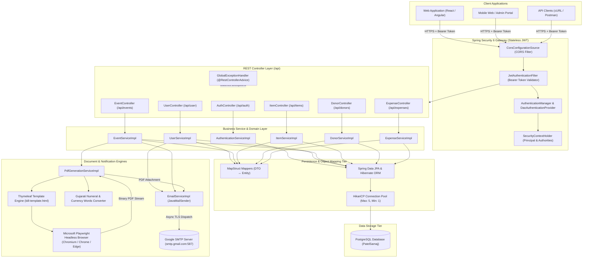
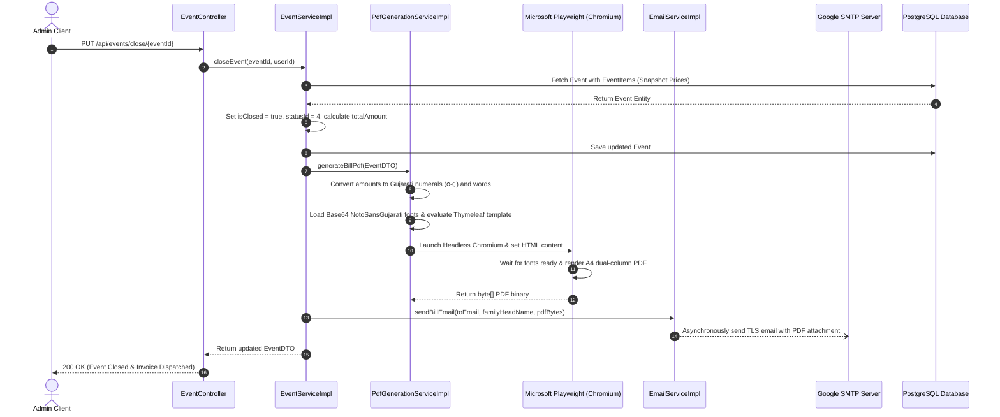

# Patel Samaj Community Management System — Backend API

[](https://www.oracle.com/java/)
[](https://spring.io/projects/spring-boot)
[-red.svg?logo=springsecurity&logoColor=white)](https://spring.io/projects/spring-security)
[](https://www.postgresql.org/)
[](https://playwright.dev/java/)
[](https://www.thymeleaf.org/)
[](https://mapstruct.org/)
[](https://www.docker.com/)

An enterprise-grade, high-performance Spring Boot RESTful backend built for managing community hall reservations, inventory catalog leasing, charitable donations, financial accounting, and automated Gujarati-localized PDF invoice dispatch with Microsoft Playwright and SMTP.

---

## 📑 Table of Contents

- [Overview](#-overview)
- [System Architecture](#-system-architecture)
  - [High-Level Architecture Diagram](#high-level-architecture-diagram)
  - [Invoice Generation & Dispatch Sequence](#invoice-generation--dispatch-sequence)
  - [Key Architectural Patterns](#key-architectural-patterns)
- [Core Features](#-core-features)
- [Technology Stack](#-technology-stack)
- [Prerequisites](#-prerequisites)
- [Configuration & Environment Variables](#-configuration--environment-variables)
- [Database Setup & Seeding](#-database-setup--seeding)
- [How to Run the Project](#-how-to-run-the-project)
  - [Option 1: Windows (Command Prompt / PowerShell)](#option-1-windows-command-prompt--powershell)
  - [Option 2: Linux / macOS (Terminal)](#option-2-linux--macos-terminal)
  - [Option 3: Build & Run Standalone JAR](#option-3-build--run-standalone-jar)
  - [Option 4: Run with Docker](#option-4-run-with-docker)
  - [Option 5: Run in IDE (IntelliJ IDEA / VS Code / Eclipse)](#option-5-run-in-ide-intellij-idea--vs-code--eclipse)
- [Playwright Browser Installation (PDF Generation)](#-playwright-browser-installation-pdf-generation)
- [REST API Reference & Quick Testing](#-rest-api-reference--quick-testing)
  - [API Endpoints Overview](#api-endpoints-overview)
  - [Sample cURL Test Workflow](#sample-curl-test-workflow)
- [Project Directory Layout](#-project-directory-layout)
- [Troubleshooting & FAQs](#-troubleshooting--faqs)
- [Documentation Links](#-documentation-links)

---

## 🌟 Overview

The **Patel Samaj Community Management System** replaces paper-based ledgers and disparate booking logs with a centralized, auditable, multi-tenant capable digital platform. It streamlines:
- **Community Hall Reservations & Scheduling:** Multi-day booking ranges with real-time calendar occupancy density analytics.
- **Dynamic Inventory Catalog:** Item rental management with immutable historical pricing snapshots.
- **Bilingual Gujarati Billing Pipeline:** Dual-column invoice layout rendered via Microsoft Playwright Headless Chromium with embedded `NotoSansGujarati` typography and native Gujarati number-to-words spelling.
- **Automated Asynchronous Emailing:** Invoices automatically emailed as PDF attachments to applicants upon booking finalization.
- **Financial Accounting & Audit Ledger:** Comprehensive tracking of charitable contributions and operational expenditures.

---

## 🏗️ System Architecture

### High-Level Architecture Diagram

The backend adheres to a clean **N-Tier Layered Architecture** with distinct separation between Presentation, Security Filter Chain, Business Domain Services, Object Mapping, Asynchronous I/O Engines, and Persistence.



---

### Invoice Generation & Dispatch Sequence

The diagram below details the automated flow when an event is finalized and locked (`PUT /api/events/close/{id}`):



---

### Key Architectural Patterns

1. **Historical Snapshot Pricing:**
   - Catalog rental prices in `items` (`current_price`) evolve over time.
   - When an event is reserved, unit prices are frozen inside `event_items` (`price_at_booking`).
   - Line totals are computed as `price_at_booking * quantity`, guaranteeing lifetime audit invariance even if the master catalog prices change later.

2. **Master Catalog Soft-Deletion:**
   - Catalog items are marked `is_deleted = true` instead of physical deletion.
   - Prevents breaking foreign keys in historical bills while excluding deleted items from future booking dropdowns (`findByIsDeletedFalse()`).

3. **Stateless JWT & Role-Based Access Control (RBAC):**
   - Every request is validated statelessly by `JwtAuthenticationFilter`.
   - Granular RBAC enforces `ROLE_ADMIN` permissions on critical write and delete endpoints (`/api/donors`, `/api/expenses`, `/api/items/**`, `/api/user/**`).

4. **Multi-Channel Headless Chromium PDF Pipeline:**
   - Replaces traditional Java PDF libraries that struggle with complex Indic Unicode conjuncts.
   - Automatically attempts to launch system Google Chrome, then Microsoft Edge, and finally falls back to Playwright's bundled Chromium binary.
   - Embedded Base64 fonts (`NotoSansGujarati`) guarantee pixel-perfect typographic rendering on any OS (Windows, Linux, macOS, or Docker).

---

## ⚡ Core Features

| Feature Module | Description | Access Level |
| :--- | :--- | :--- |
| **Authentication & Tokens** | Mobile number + password authentication with stateless JWT token generation and password reset via email. | Public (`/api/auth/**`) |
| **User & Staff Administration** | Invite new administrators, toggle activation status, manage profiles, and update credentials. | `ROLE_ADMIN` |
| **Hall & Event Reservations** | Multi-day bookings, item selections, draft status, and calendar event density aggregations for frontend heatmaps. | Authenticated |
| **Invoice Finalization** | Closing events, calculating frozen price totals, rendering Gujarati PDF invoices, and dispatching via SMTP. | `ROLE_ADMIN` |
| **Catalog Management** | Register, update, and soft-delete equipment and hall facilities with current pricing and descriptions. | `ROLE_ADMIN` / Authenticated (Read) |
| **Donations Ledger** | Record charitable community donations, donor details, amounts, and audit notes. | `ROLE_ADMIN` (Write) / Authenticated (Read) |
| **Expense Tracking** | Categorized daily expenditures (utilities, maintenance, construction) with date-range filters. | `ROLE_ADMIN` (Write) / Authenticated (Read) |

---

## 💻 Technology Stack

| Layer | Component | Version / Details |
| :--- | :--- | :--- |
| **Language** | Java | 17 LTS (Tested up to Java 21) |
| **Framework** | Spring Boot | 4.0.6 |
| **Security** | Spring Security & JJWT | 6.x / `io.jsonwebtoken:jjwt 0.11.5` |
| **Database & ORM** | PostgreSQL & Spring Data JPA | PostgreSQL 14+, Hibernate, HikariCP |
| **Document Generation** | Microsoft Playwright | 1.61.0 (Headless Chromium) |
| **Templating Engine** | Thymeleaf | 3.x (Dual-column Gujarati bill template) |
| **Object Mapping** | MapStruct | 1.5.5.Final with Lombok binding |
| **Utility** | Project Lombok | Auto-generates getters, setters, builders |
| **Build Tool** | Apache Maven | 3.8+ (Wrapper included: `./mvnw`) |
| **Containerization** | Docker | Multi-stage Dockerfile (Temurin 17 JRE) |

---

## 📋 Prerequisites

Before running the backend, make sure you have installed:

1. **Java Development Kit (JDK 17 or higher):**
   - [Eclipse Temurin 17](https://adoptium.net/temurin/releases/?version=17) or Oracle JDK 17+.
   - Verify installation:
     ```bash
     java -version
     ```
2. **PostgreSQL (14 or higher):**
   - Local PostgreSQL service, a Docker container, or cloud-managed PostgreSQL (e.g. [Neon](https://neon.tech/), [Supabase](https://supabase.com/)).
   - Verify database server running:
     ```bash
     psql -U postgres -h localhost
     ```
3. **Microsoft Edge or Google Chrome Browser:**
   - Playwright will automatically detect existing system installations of Chrome or Edge for PDF rendering.
   - If running in a headless Linux environment, install Playwright Chromium (see [Playwright section](#-playwright-browser-installation-pdf-generation)).
4. **Git & Maven (Optional):**
   - Maven 3.8+ is optional since the project includes the Maven Wrapper (`./mvnw` and `mvnw.cmd`).

---

## ⚙️ Configuration & Environment Variables

All settings in `src/main/resources/application.properties` can be configured via environment variables or a `.env` file.

| Environment Variable | Description | Default Fallback Value |
| :--- | :--- | :--- |
| `PORT` | HTTP Server port | `8080` |
| `DB_URL` | PostgreSQL JDBC connection URL | `jdbc:postgresql://localhost:5432/PatelSamaj` |
| `DB_USER` | PostgreSQL username | `postgres` |
| `DB_PASSWORD` | PostgreSQL password | `postgres` |
| `JWT_SECRET` | 256-bit secret key used for signing JWT tokens | `sfjehfcawndawlecjwlf342nhwldwlmxkedewhndhfiwelcfsnejfd` |
| `JWT_EXPIRE` | JWT token validity in milliseconds | `86400000` (24 hours) |
| `CORS_ALLOWED_ORIGINS`| Allowed Frontend Origin for CORS | `http://localhost:8081` |
| `MAIL_HOST` | SMTP server host | `smtp.gmail.com` |
| `MAIL_PORT` | SMTP server port | `587` |
| `MAIL_USERNAME` | SMTP account email address | `patelsamajbildi@gmail.com` |
| `MAIL_PASSWORD` | SMTP password (or Google App Password) | `your_gmail_app_password` |

> [!TIP]
> **Setting up Gmail SMTP:**
> If you are using Gmail, enable **2-Step Verification** in your Google Account and generate an **App Password** under Security > 2-Step Verification > App Passwords. Use that 16-character string as `MAIL_PASSWORD`.

---

## 🗄️ Database Setup & Seeding

### 1. Create the Database

Log in to your PostgreSQL instance using `psql` or pgAdmin and run:

```sql
CREATE DATABASE "PatelSamaj";
```

### 2. Schema Auto-Generation

The backend is configured with `spring.jpa.hibernate.ddl-auto=update`. When the application starts for the first time, Hibernate will automatically create all tables (`roles`, `users`, `items`, `events`, `event_items`, `donors`, `expenses`) and constraints.

### 3. Seed Initial Roles & Super Admin User

Run the following SQL script to create the initial `ADMIN` role and the first administrative user:

```sql
-- Connect to the database
\c PatelSamaj;

-- 1. Insert the mandatory ADMIN role (Role ID = 1)
INSERT INTO roles (role_id, role_name)
VALUES (1, 'ADMIN')
ON CONFLICT (role_name) DO NOTHING;

-- 2. Insert the Super Admin User
-- Default Credentials -> Mobile: 9999999999 | Password: password
-- The password hash below corresponds to 'password' encoded with BCrypt
INSERT INTO users (user_id, full_name, mobile_number, email, password, role_id, is_active, created_at, created_by)
VALUES (
    1,
    'System Administrator',
    '9999999999',
    'admin@patelsamaj.org',
    '$2a$10$7JB720yubVSZvUI0rEqK/.VqGOZTH.ulu33dHOiBE8ByOhJIrdAu2',
    1,
    true,
    NOW(),
    1
)
ON CONFLICT (mobile_number) DO NOTHING;

-- 3. Insert Starter Catalog Items (Optional)
INSERT INTO items (item_id, item_name, current_price, description, is_deleted, created_by)
VALUES 
    (1, 'Community Hall Day Rent', 15000, 'Main banquet hall for 24 hours', false, 1),
    (2, 'Dining Chairs (Set of 100)', 1500, 'Plastic armless banquet chairs', false, 1),
    (3, 'Dining Tables (Set of 10)', 1000, 'Folding wooden banquet tables', false, 1),
    (4, 'Sound System & Microphones', 3000, 'Dual speaker PA system with 2 wireless mics', false, 1),
    (5, 'Cooking Utensil Package', 2500, 'Complete commercial kitchen pots and burners', false, 1)
ON CONFLICT DO NOTHING;

-- Reset primary key sequences
SELECT setval('roles_role_id_seq', (SELECT MAX(role_id) FROM roles));
SELECT setval('users_user_id_seq', (SELECT MAX(user_id) FROM users));
SELECT setval('items_item_id_seq', (SELECT MAX(item_id) FROM items));
```

---

## 🚀 How to Run the Project

Clone the repository to your local machine:

```bash
git clone https://github.com/your-username/patelsamaj-backend.git
cd patelsamaj-backend
```

### Option 1: Windows (Command Prompt / PowerShell)

Run the backend directly using the bundled Windows Maven wrapper:

```powershell
# Set environment variables (Optional, if different from defaults)
$env:PORT="8080"
$env:DB_URL="jdbc:postgresql://localhost:5432/PatelSamaj"
$env:DB_USER="postgres"
$env:DB_PASSWORD="your_password"

# Launch Spring Boot
.\mvnw.cmd clean spring-boot:run
```

---

### Option 2: Linux / macOS (Terminal)

```bash
# Ensure execution permissions for the wrapper
chmod +x mvnw

# Export environment variables (Optional)
export PORT=8080
export DB_URL="jdbc:postgresql://localhost:5432/PatelSamaj"
export DB_USER="postgres"
export DB_PASSWORD="your_password"

# Launch Spring Boot
./mvnw clean spring-boot:run
```

---

### Option 3: Build & Run Standalone JAR

```bash
# Package into executable JAR (skipping test suite for quick build)
./mvnw clean package -DskipTests

# Run the produced JAR
java -jar target/patelsamaj-backend-0.0.1-SNAPSHOT.jar
```

---

### Option 4: Run with Docker

The repository includes a multi-stage `Dockerfile`:

```bash
# Build the Docker image
docker build -t patelsamaj-backend:latest .

# Run the container with environment variables
docker run -d \
  -p 8080:10000 \
  --name patelsamaj-backend \
  -e DB_URL="jdbc:postgresql://host.docker.internal:5432/PatelSamaj" \
  -e DB_USER="postgres" \
  -e DB_PASSWORD="your_password" \
  -e JWT_SECRET="your_long_base64_jwt_secret_key" \
  -e CORS_ALLOWED_ORIGINS="http://localhost:3000" \
  patelsamaj-backend:latest
```

---

### Option 5: Run in IDE (IntelliJ IDEA / VS Code / Eclipse)

1. **IntelliJ IDEA:**
   - Open IntelliJ IDEA and choose **File > Open**, then select the `patelsamaj-backend` directory.
   - Wait for Maven dependencies to download and index.
   - Go to **Settings > Build, Execution, Deployment > Compiler > Annotation Processors** and ensure **Enable annotation processing** is checked (required for MapStruct and Lombok).
   - Navigate to `src/main/java/com/patelsamaj/patelsamaj_backend/PatelSamajBackendApplication.java`.
   - Click the green **Run** icon.

2. **VS Code:**
   - Install the **Extension Pack for Java** and **Spring Boot Extension Pack**.
   - Open the root folder.
   - Run via the Spring Boot Dashboard or press `F5`.

Once running, the server starts on `http://localhost:8080`.

---

## 🌐 Playwright Browser Installation (PDF Generation)

The billing service generates invoices using Microsoft Playwright in headless mode.

1. **Automatic Browser Detection:**
   The backend first attempts to launch system-installed **Google Chrome**, then **Microsoft Edge**. On Windows and macOS developer machines, no extra browser installation is usually required.

2. **Installing Playwright Chromium on Headless Linux / Docker:**
   If running on a Linux server without Chrome or Edge, install Playwright's Chromium browser binary using Maven:
   ```bash
   ./mvnw exec:java -e -D exec.mainClass=com.microsoft.playwright.CLI -D exec.args="install chromium"
   ```

3. **Linux OS Dependencies (Ubuntu/Debian):**
   ```bash
   ./mvnw exec:java -e -D exec.mainClass=com.microsoft.playwright.CLI -D exec.args="install-deps"
   ```

---

## 📡 REST API Reference & Quick Testing

### API Endpoints Overview

| Module | Method | Endpoint | Authorization | Description |
| :--- | :--- | :--- | :--- | :--- |
| **Auth** | `POST` | `/api/auth/login` | Public | Authenticate via mobile & password; returns JWT token. |
| **Auth** | `POST` | `/api/auth/logout` | Public | Clears SecurityContext. |
| **Auth** | `POST` | `/api/auth/forgot-password`| Public | Reset password and send temporary password via email. |
| **Users** | `GET` | `/api/user/profile` | Authenticated | Retrieve authenticated admin profile. |
| **Users** | `PUT` | `/api/user/profile` | `ROLE_ADMIN` | Update user profile details. |
| **Users** | `POST` | `/api/user/invite` | `ROLE_ADMIN` | Invite a new admin user and send credentials via email. |
| **Users** | `GET` | `/api/user` | `ROLE_ADMIN` | Paginated search of all administrators. |
| **Users** | `PATCH`| `/api/user/{id}/toggle-status`| `ROLE_ADMIN` | Toggle administrator active/inactive status. |
| **Events** | `POST` | `/api/events` | Authenticated | Create a new community hall / item reservation. |
| **Events** | `GET` | `/api/events/{id}` | Authenticated | Get detailed event booking by ID. |
| **Events** | `GET` | `/api/events/status/{id}` | Authenticated | Paginated events by status (`1=Draft`, `2/3=Confirmed`, `4=Closed`). |
| **Events** | `PUT` | `/api/events/close/{id}`| `ROLE_ADMIN` | Lock event, calculate bill, generate PDF, and send email. |
| **Events** | `GET` | `/api/events/calendar/count`| Authenticated | Get date-wise event density count for booking calendar. |
| **Items** | `GET` | `/api/items` | Authenticated | Retrieve active catalog items (`is_deleted = false`). |
| **Items** | `POST` | `/api/items` | `ROLE_ADMIN` | Add new catalog item with rental price. |
| **Items** | `PUT` | `/api/items/{id}` | `ROLE_ADMIN` | Update catalog item details and pricing. |
| **Items** | `DELETE`| `/api/items/{id}` | `ROLE_ADMIN` | Soft-delete catalog item. |
| **Donors** | `GET` | `/api/donors` | Authenticated | Paginated list of charitable contributions. |
| **Donors** | `POST` | `/api/donors` | `ROLE_ADMIN` | Record new donation. |
| **Donors** | `DELETE`| `/api/donors/{id}` | `ROLE_ADMIN` | Delete donation record. |
| **Expenses**| `GET` | `/api/expenses` | Authenticated | Paginated list of operational expenses with date filters. |
| **Expenses**| `POST` | `/api/expenses` | `ROLE_ADMIN` | Record an operational expenditure. |
| **Expenses**| `DELETE`| `/api/expenses/{id}`| `ROLE_ADMIN` | Delete an expense entry. |

> Complete request/response schemas, validation rules, and error envelopes are available in **[docs/API_DOCUMENTATION.md](./docs/API_DOCUMENTATION.md)**.

---

### Sample cURL Test Workflow

#### 1. Authenticate & Obtain JWT Token

```bash
curl -X POST http://localhost:8080/api/auth/login \
  -H "Content-Type: application/json" \
  -d '{
    "mobileNumber": "9999999999",
    "password": "password"
  }'
```

*Response:*
```text
eyJhbGciOiJIUzI1NiJ9.eyJzdWIiOiI5OTk5OTk5OTk5IiwiaWF0IjoxNzE2...
```

Save this token to an environment variable:
```bash
export TOKEN="<paste_jwt_token_here>"
```

#### 2. Fetch Item Catalog

```bash
curl -X GET http://localhost:8080/api/items \
  -H "Authorization: Bearer $TOKEN"
```

#### 3. Create an Event Booking

```bash
curl -X POST http://localhost:8080/api/events \
  -H "Authorization: Bearer $TOKEN" \
  -H "Content-Type: application/json" \
  -d '{
    "familyHeadName": "Rameshbhai Patel",
    "contactNumber": "9825012345",
    "email": "ramesh.patel@example.com",
    "eventType": "Marriage Ceremony",
    "startDate": "2026-12-01T09:00:00",
    "endDate": "2026-12-03T18:00:00",
    "items": [
      { "itemId": 1, "quantity": 1 },
      { "itemId": 2, "quantity": 2 }
    ]
  }'
```

#### 4. Close Event, Generate Gujarati PDF & Dispatch Email

```bash
curl -X PUT http://localhost:8080/api/events/close/1 \
  -H "Authorization: Bearer $TOKEN"
```

---

## 📁 Project Directory Layout

```text
patelsamaj-backend/
├── .mvn/wrapper/                  # Maven Wrapper binaries
├── docs/                          # Detailed Technical Specifications
│   ├── API_DOCUMENTATION.md       # Comprehensive REST API contracts & cURL tests
│   ├── ER_DIAGRAM.md              # Database schemas, relational tables & ER diagram
│   └── PORTFOLIO_CASE_STUDY.md    # Architecture case study & portfolio highlights
├── src/
│   ├── main/
│   │   ├── java/com/patelsamaj/patelsamaj_backend/
│   │   │   ├── config/            # Security, PasswordEncoder, RestTemplate beans
│   │   │   ├── controller/        # REST Controllers (Auth, Events, Users, etc.)
│   │   │   ├── dto/               # Data Transfer Objects & Validation annotations
│   │   │   ├── exception/         # Custom exceptions & GlobalExceptionHandler
│   │   │   ├── helper/            # Security context helper utilities
│   │   │   ├── mapper/            # MapStruct DTO ↔ Entity interfaces
│   │   │   ├── model/             # JPA Entities (Event, User, Item, Role, etc.)
│   │   │   ├── repository/        # Spring Data JPA Repository interfaces
│   │   │   ├── security/          # JwtService, JwtAuthenticationFilter, SecurityConfig
│   │   │   └── service/           # Service interfaces and implementations
│   │   │       └── impl/          # Core business logic (PDF, Mail, Event, User)
│   │   └── resources/
│   │       ├── fonts/             # Embedded TrueType Gujarati fonts (NotoSansGujarati)
│   │       ├── templates/         # Thymeleaf bill template (bill-template.html)
│   │       └── application.properties # Main application configuration
│   └── test/                      # Unit & integration test suites
├── Dockerfile                     # Multi-stage Docker build configuration
├── mvnw                           # Linux/macOS Maven wrapper script
├── mvnw.cmd                       # Windows Maven wrapper batch script
├── pom.xml                        # Maven dependencies & build plugins
└── README.md                      # Primary project guide
```

---

## ❓ Troubleshooting & FAQs

### 1. `org.postgresql.util.PSQLException: Connection refused`
- **Cause:** PostgreSQL service is not running or the database credentials in `application.properties` / environment variables are incorrect.
- **Solution:** Verify that PostgreSQL is active (`Get-Service postgresql*` on Windows or `sudo systemctl status postgresql` on Linux) and that the database `PatelSamaj` exists.

### 2. `BrowserType.launch: Executable doesn't exist`
- **Cause:** Playwright cannot find Google Chrome, Microsoft Edge, or its downloaded Chromium binary.
- **Solution:** Run the browser installation command:
  ```bash
  ./mvnw exec:java -e -D exec.mainClass=com.microsoft.playwright.CLI -D exec.args="install chromium"
  ```

### 3. `AuthenticationFailedException: 535-5.7.8 Username and Password not accepted`
- **Cause:** Incorrect Gmail credentials or standard password used instead of a Google App Password.
- **Solution:** Generate an **App Password** from your Google Account (Security > 2-Step Verification > App Passwords) and supply it as `MAIL_PASSWORD`.

### 4. MapStruct or Lombok Compilation Errors (`cannot find symbol`)
- **Cause:** Annotation processing is not enabled in your IDE, or compiler order is out of sync.
- **Solution:** Enable annotation processing in your IDE settings. When compiling from the terminal, run `./mvnw clean compile` to ensure MapStruct generates mapper implementations under `target/generated-sources`.

### 5. `Port 8080 is already in use`
- **Cause:** Another process is listening on port 8080.
- **Solution:** Change the port using the environment variable:
  ```bash
  export PORT=8082
  ./mvnw spring-boot:run
  ```

---

## 📚 Documentation Links

For in-depth architectural and schema references, explore the dedicated documentation suite:

- 📊 **[Entity Relationship (ER) Diagram & Schema Architecture](./docs/ER_DIAGRAM.md)**
- 📖 **[Comprehensive REST API Documentation](./docs/API_DOCUMENTATION.md)**
- 💼 **[Portfolio Case Study & Technical Highlights](./docs/PORTFOLIO_CASE_STUDY.md)**

---

## 📄 License & Maintenance

Developed for the **Patel Samaj Community Organization**.  
For inquiries, contributions, or technical questions, please open an issue or reach out to the project maintainers.
