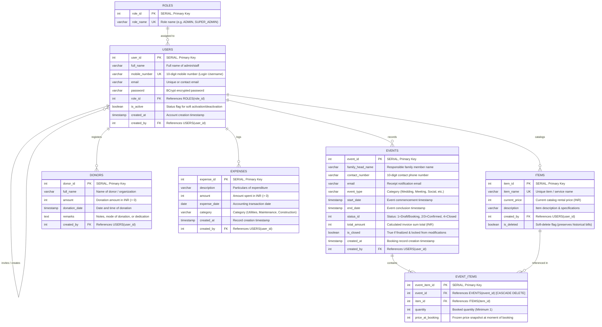

# Entity Relationship (ER) Diagram & Database Architecture

## Patel Samaj Community Management System (Backend)

This document provides a comprehensive specification of the relational database architecture, entity schemas, constraints, and relational design patterns for the **Patel Samaj Backend**.

---

## 1. High-Level Entity Relationship Diagram (ERD)

The database schema is designed for PostgreSQL using Spring Data JPA and Hibernate. It manages community user authentication, role-based access control (RBAC), community hall/asset event bookings with pricing snapshots, item inventory, charitable donations, and daily expenditure tracking.

---

## 2. Relational Schema & Data Dictionary

### 2.1. Table: `roles`
Stores access control roles for system administrators and staff.

| Column | Data Type | Constraints | Default | Description |
| :--- | :--- | :--- | :--- | :--- |
| `role_id` | `INTEGER` | `PRIMARY KEY`, `AUTO_INCREMENT` | Serial sequence | Unique role identifier. |
| `role_name` | `VARCHAR(255)` | `NOT NULL`, `UNIQUE` | None | Name of the role (e.g., `ADMIN`, `ROLE_ADMIN`). |

---

### 2.2. Table: `users`
Represents administrative operators and members with system access. Implements Spring Security's `UserDetails` where the username is `mobile_number`.

| Column | Data Type | Constraints | Default | Description |
| :--- | :--- | :--- | :--- | :--- |
| `user_id` | `INTEGER` | `PRIMARY KEY`, `AUTO_INCREMENT` | Serial sequence | Unique user identifier. |
| `full_name` | `VARCHAR(255)` | `NOT NULL` | None | Full legal name of the user. |
| `mobile_number` | `VARCHAR(255)` | `NOT NULL`, `UNIQUE` | None | 10-digit mobile number used as login username. |
| `email` | `VARCHAR(255)` | `NULLABLE` | None | Email address used for notifications and credential delivery. |
| `password` | `VARCHAR(255)` | `NOT NULL` | None | BCrypt hashed password. |
| `role_id` | `INTEGER` | `NOT NULL`, `FOREIGN KEY` | None | References `roles(role_id)`. Eagerly fetched. |
| `is_active` | `BOOLEAN` | `NOT NULL` | `true` | Allows enabling/disabling login access without deleting record. |
| `created_at` | `TIMESTAMP` | `NOT NULL` | `CURRENT_TIMESTAMP` | Account creation timestamp. |
| `created_by` | `INTEGER` | `NULLABLE`, `FOREIGN KEY` | None | User ID of administrator who invited this user. |

---

### 2.3. Table: `items` (Asset Catalog / Inventory)
Master inventory of rentable assets (e.g., community halls, sound systems, tables, chairs, kitchen utensils, decorations).

| Column | Data Type | Constraints | Default | Description |
| :--- | :--- | :--- | :--- | :--- |
| `item_id` | `INTEGER` | `PRIMARY KEY`, `AUTO_INCREMENT` | Serial sequence | Unique catalog item ID. |
| `item_name` | `VARCHAR(255)` | `NOT NULL`, `UNIQUE` | None | Unique name/title of the inventory item or amenity. |
| `current_price` | `INTEGER` | `NOT NULL`, `>= 0` | None | Current unit rental price in Indian Rupees (INR). |
| `description` | `VARCHAR(255)` | `NULLABLE` | None | Technical or descriptive details of the asset. |
| `created_by` | `INTEGER` | `NULLABLE`, `FOREIGN KEY` | None | Admin ID who registered the item. |
| `is_deleted` | `BOOLEAN` | `NOT NULL` | `false` | Soft deletion flag to preserve historical bill integrity. |

---

### 2.4. Table: `events` (Bookings & Invoicing)
Represents reservations for weddings, meetings, community gatherings, and general ceremonies.

| Column | Data Type | Constraints | Default | Description |
| :--- | :--- | :--- | :--- | :--- |
| `event_id` | `INTEGER` | `PRIMARY KEY`, `AUTO_INCREMENT` | Serial sequence | Unique booking bill ID. |
| `family_head_name`| `VARCHAR(255)` | `NOT NULL` | None | Primary contact person / host booking the premises. |
| `contact_number` | `VARCHAR(255)` | `NOT NULL` | None | 10-digit phone number. |
| `email` | `VARCHAR(255)` | `NULLABLE` | None | Recipient email for automated PDF bill dispatch. |
| `event_type` | `VARCHAR(255)` | `NULLABLE` | None | Type of occasion (e.g., Wedding, Meeting, Social Function). |
| `start_date` | `TIMESTAMP` | `NOT NULL` | None | Booking start timestamp. |
| `end_date` | `TIMESTAMP` | `NULLABLE` | None | Booking end timestamp. |
| `status_id` | `INTEGER` | `NOT NULL` | `1` | Booking workflow state (`1`=Draft/Created, `2`/`3`=Confirmed/Active, `4`=Closed). |
| `total_amount` | `INTEGER` | `NOT NULL`, `>= 0` | `0` | Total cost computed as $\sum (\text{priceAtBooking} \times \text{quantity})$. |
| `is_closed` | `BOOLEAN` | `NOT NULL` | `false` | Bill lock status. Once closed, updates are strictly rejected. |
| `created_at` | `TIMESTAMP` | `NOT NULL` | `CURRENT_TIMESTAMP` | Record creation timestamp. |
| `created_by` | `INTEGER` | `NULLABLE`, `FOREIGN KEY` | None | Admin ID who created the booking record. |

---

### 2.5. Table: `event_items` (Booking Line Items / Historical Snapshots)
Junction table with pricing snapshot attributes connecting `events` and `items`.

| Column | Data Type | Constraints | Default | Description |
| :--- | :--- | :--- | :--- | :--- |
| `event_item_id` | `INTEGER` | `PRIMARY KEY`, `AUTO_INCREMENT` | Serial sequence | Unique line item identifier. |
| `event_id` | `INTEGER` | `NOT NULL`, `FOREIGN KEY` | None | Foreign key referencing `events(event_id)`. Cascade DELETE. |
| `item_id` | `INTEGER` | `NOT NULL`, `FOREIGN KEY` | None | Foreign key referencing master `items(item_id)`. |
| `quantity` | `INTEGER` | `NOT NULL`, `>= 1` | `1` | Count or unit amount booked. |
| `price_at_booking`| `INTEGER` | `NOT NULL`, `>= 0` | None | **Snapshot Price**: Copies `current_price` when booked to insulate past bills from future price changes. |

---

### 2.6. Table: `donors` (Philanthropic Contributions)
Tracks community donations, patron contributions, and building funds.

| Column | Data Type | Constraints | Default | Description |
| :--- | :--- | :--- | :--- | :--- |
| `donor_id` | `INTEGER` | `PRIMARY KEY`, `AUTO_INCREMENT` | Serial sequence | Unique donor record identifier. |
| `full_name` | `VARCHAR(150)` | `NOT NULL` | None | Full legal or family name of the donor. |
| `amount` | `INTEGER` | `NOT NULL`, `> 0` | None | Donated monetary amount (INR). |
| `donation_date` | `TIMESTAMP` | `NOT NULL` | `CURRENT_TIMESTAMP` | Timestamp when donation was received. |
| `remarks` | `TEXT` | `NULLABLE` | None | Additional remarks (cheque no, purpose, memorial, etc.). |
| `created_by` | `INTEGER` | `NULLABLE`, `FOREIGN KEY` | None | Admin ID who recorded the transaction. |

---

### 2.7. Table: `expenses` (Community Expenditures & Cash Outflows)
Records maintenance costs, utility payments, construction materials, and administrative overheads.

| Column | Data Type | Constraints | Default | Description |
| :--- | :--- | :--- | :--- | :--- |
| `expense_id` | `INTEGER` | `PRIMARY KEY`, `AUTO_INCREMENT` | Serial sequence | Unique expense record identifier. |
| `description` | `VARCHAR(255)` | `NOT NULL` | None | Particulars/reason for the expenditure. |
| `amount` | `INTEGER` | `NOT NULL`, `> 0` | None | Expense amount (INR). |
| `expense_date` | `DATE` | `NOT NULL` | None | Date of expense transaction. |
| `category` | `VARCHAR(255)` | `NULLABLE` | None | Expense category (e.g., Construction, Maintenance, Utilities). |
| `created_at` | `TIMESTAMP` | `NOT NULL` | `CURRENT_TIMESTAMP` | Audit creation timestamp. |
| `created_by` | `INTEGER` | `NULLABLE`, `FOREIGN KEY` | None | Admin ID who submitted the expense entry. |

---

## 3. Key Architectural & Database Design Patterns

### 1. The Historical Pricing Snapshot Pattern
- **Challenge:** If an organization raises the rental fee of a hall or equipment from ₹5,000 to ₹7,000, historical bills generated months ago must not retroactively change their totals.
- **Solution:** While `items` retains `current_price`, `event_items` captures `price_at_booking`. When a booking is created or updated, the service layer queries `masterItem.getCurrentPrice()` and persists it permanently into `event_items.price_at_booking`.

### 2. Soft-Delete Protection for Master Inventory
- **Challenge:** Deleting a catalog item from `items` would violate foreign key constraints in `event_items` or orphan past bills.
- **Solution:** The `items` table implements soft deletion (`is_deleted = true`). The repository filters out inactive items for new bookings via `findByIsDeletedFalse()`, while historical bills safely maintain their relational references.

### 3. Immutable Invoice Locking Pattern
- **Challenge:** Preventing tampering or unintended modifications to community invoices after conclusion.
- **Solution:** When an event is closed via `/api/events/{id}/close`, the `is_closed` flag is set to `true` and `status_id` is updated to `4`. Any subsequent invocation of `upsertEvent()` throws an `IllegalStateException ("Bill is finalized and locked.")`.

### 4. Audit Trail Tracking
- All operational entities (`events`, `items`, `donors`, `expenses`, `users`) contain `created_by` and/or `created_at` audit fields. The system automatically populates `created_by` using `SecurityUtils.getAuthenticatedUserId()`, extracting the principal directly from Spring Security's `SecurityContext`.

### 5. Multi-Day Event Aggregation Architecture
- To support intuitive calendar visualizers on the frontend, the database layer queries active/confirmed events (`findFutureEventsByStatusIds`), and the service aggregates multi-day intervals into date-indexed frequencies (`Map<String, Integer>`) to render event density across calendar days.
