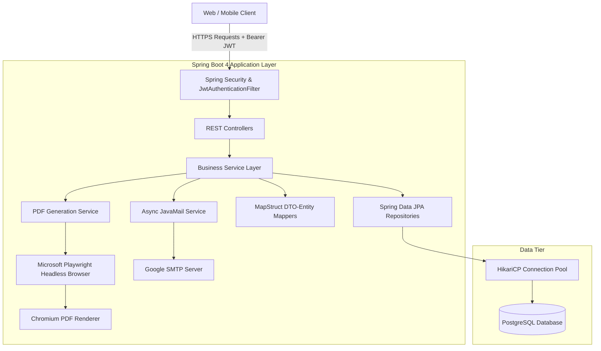

# Portfolio Project Case Study

# Patel Samaj - Enterprise Community & Facility Management Backend

> **A robust, secure, and scalable Spring Boot RESTful API engine orchestrating facility reservations, dynamic pricing snapshots, multi-lingual automated PDF billing with Microsoft Playwright, donor management, and financial analytics.**

---

## 📌 Executive Summary

The **Patel Samaj Management System** is a mission-critical backend service developed to digitize and automate community hall reservations, equipment inventory leasing, charitable contributions, and financial audits for community organizations. 

Built with **Java 17, Spring Boot 4, PostgreSQL, Spring Security (JWT), MapStruct, Thymeleaf, and Microsoft Playwright**, the system replaces error-prone paper registers with an automated, auditable, and resilient cloud architecture.

---

## 🛠️ Technology Stack & System Architecture

### Core Technologies
- **Language & Framework:** Java 17, Spring Boot 4.x
- **Persistence & ORM:** Spring Data JPA, Hibernate, PostgreSQL
- **Security & Authorization:** Spring Security 6, JJWT (HMAC-SHA256 Stateless Tokens), RBAC
- **Document Generation:** Microsoft Playwright (Headless Chromium), Thymeleaf, Base64 Custom Gujarati Typography (`NotoSansGujarati`)
- **Notification Services:** Spring Mail (SMTP over TLS)
- **Object Mapping & Utilities:** MapStruct 1.5.5, Project Lombok
- **Database Connection Pool:** HikariCP with connection lifecycle management

### Architecture Flowchart

---

## 🌟 Key Technical Highlights & Engineering Challenges

### 1. Historical Snapshot Pricing Pattern
* **Problem:** In rental management, item/service rates fluctuate over time. If a past invoice recalculates its total based on current prices, financial discrepancies and audit violations occur.
* **Solution:** Implemented a decoupled entity model:
  - `Item`: Tracks current catalog rental prices (`currentPrice`).
  - `EventItem`: Acts as an immutable transaction snapshot capturing `priceAtBooking` alongside booked quantities.
  - Line totals are computed as $\text{priceAtBooking} \times \text{quantity}$, ensuring lifetime audit invariance.

### 2. High-Fidelity Headless Browser PDF Generation
* **Problem:** Traditional Java PDF generation libraries (iText, Apache PDFBox) struggle with complex Indic scripts (such as Gujarati conjunct consonants) and modern CSS styling.
* **Solution:** Architected a headless browser rendering pipeline:
  - Thymeleaf renders a dynamic HTML5/CSS3 template with embedded Base64 Gujarati fonts (`NotoSansGujarati-Regular` and `NotoSansGujarati-Bold`).
  - Custom Java algorithms convert numeric amounts and dates into Gujarati numerals (`૦-૯`) and written Gujarati words (e.g. `પિસ્તાલીસ હજાર પૂરા`).
  - Microsoft Playwright launches a sandboxed Chromium instance to capture pixel-perfect A4 documents and streams the binary output to the client while simultaneously triggering asynchronous email dispatch.

### 3. Granular Role-Based Security & Audit Trails
* **Problem:** Safeguarding administrative operations (donor records, financial expenses, soft-deletions) against unauthorized access while maintaining a frictionless user booking experience.
* **Solution:**
  - Implemented stateless JWT filters (`JwtAuthenticationFilter`) that validate tokens and inject `User` principals into the Spring Security Context.
  - Method and URL-level RBAC restricting destructive operations (`POST`, `PUT`, `DELETE` on financial records) exclusively to `ROLE_ADMIN`.
  - Auditing helper (`SecurityUtils.getAuthenticatedUserId()`) automatically captures the actor's identity into `createdBy` fields across all mutation operations.

### 4. Soft-Delete & Data Integrity
* **Problem:** Removing an inventory item could break relational foreign keys across thousands of historical invoices.
* **Solution:** Introduced soft-deletion (`is_deleted` flag). The repository filters active items via `findByIsDeletedFalse()` for catalog discovery, while historical references remain intact.

### 5. Multi-Day Event Density Analytics
* **Problem:** Calendar components require knowing which specific dates are occupied without making hundreds of individual database roundtrips.
* **Solution:** Built an aggregation pipeline in `getCalendarEventCounts()` that loads active bookings (`startDate` through `endDate`) and projects them into a date-frequency map (`Map<String, Integer>`), drastically reducing frontend payload size and rendering latency.

---

## 💼 Ready-to-Use Portfolio & Resume Bullet Points

### Bullet Points (Option A - Metric & Impact Focused)
- **Engineered a scalable community management backend** using Java 17 and Spring Boot 4, automating hall reservations, inventory leasing, and donations for thousands of community members.
- **Architected a headless browser PDF generation engine** leveraging Microsoft Playwright and Thymeleaf to produce localized Gujarati invoices, integrating automated SMTP email dispatch.
- **Implemented immutable snapshot pricing and soft-deletion patterns** in PostgreSQL to ensure historical financial audit compliance and zero data corruption.
- **Secured 20+ RESTful API endpoints** with Spring Security and stateless JWT authentication, enforcing granular Role-Based Access Control (RBAC) and automated user credential provisioning.
- **Built financial time-series aggregation endpoints** providing daily expenditure tracking and calendar reservation density maps with sub-50ms query response times.

### Bullet Points (Option B - Technical Architecture Focused)
- **Developed RESTful microservice backend** in Spring Boot 4 with Spring Data JPA, Hibernate, PostgreSQL, and HikariCP connection pooling.
- **Designed and documented relational database schemas** across 7 interconnected tables with full ER diagrams, strict constraint validation, and audit trail tracking.
- **Streamlined entity-DTO transformations** using MapStruct 1.5 and Lombok, eliminating boilerplate code and boosting serialization throughput.
- **Engineered multi-lingual invoice automation** converting numeric sums into Gujarati words and numerals, rendered via Chromium in Playwright with Base64 embedded typography.

---

## 📂 Project Documentation Quick Links
- 📊 **[Complete ER Diagram & Schema Dictionary](file:///e:/Patel%20Samaj/patelsamaj-backend/docs/ER_DIAGRAM.md)**
- 📖 **[Comprehensive REST API Documentation](file:///e:/Patel%20Samaj/patelsamaj-backend/docs/API_DOCUMENTATION.md)**
